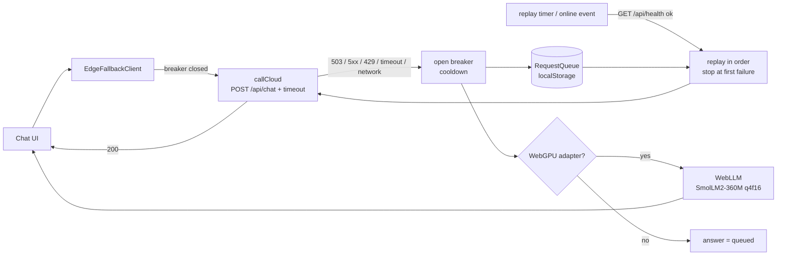

# webgpu-edge-fallback

A browser chat client that calls a cloud LLM API first and, when the cloud returns 5xx/429, times out or the network drops, answers with a small model running **in the browser on WebGPU** (WebLLM, SmolLM2-360M-Instruct q4f16). Every request the cloud did not answer goes into a persistent offline queue that replays, in order, when the cloud's health check passes again.

## Why
Cloud LLM endpoints fail in boring ways: overload 503s, slow tails, flaky mobile networks. A user should still get *an* answer, and the system of record should still get the request. This repo shows the client-side half of that: failure classification, a circuit breaker, an edge model, and a durable replay queue — with tests that run against a mocked cloud.

## Architecture


## How it works
- [`src/cloud.js`](src/cloud.js) — `callCloud` uses `AbortController` for a hard timeout and classifies failures: `timeout`, `network`, `http_5xx`, `http_429` → fall back; other 4xx → `CloudClientError` is thrown (a caller bug must not be hidden by a fallback).
- [`src/client.js`](src/client.js) — `EdgeFallbackClient.ask()` tries the cloud unless the breaker is open, then queues the request and asks the local engine. Result carries `source` (`cloud` | `local` | `queued`), `reason`, and latency. `replayIfHealthy()` checks `/api/health` before replaying.
- [`src/queue.js`](src/queue.js) — `RequestQueue` persists to `localStorage` (survives reloads), caps size (drops oldest), replays FIFO and stops at the first failure so later requests never overtake earlier ones.
- [`src/local-engine.js`](src/local-engine.js) — detects `navigator.gpu` **and** a real adapter; only then imports WebLLM (`@mlc-ai/web-llm@0.2.79` from esm.run). Without WebGPU it returns no engine and the UI says requests will queue.
- [`server/dev-server.mjs`](server/dev-server.mjs) — static server plus a **mock** cloud with switchable modes (`ok` / `503` / `timeout`) for manual demos.

## Results
All numbers below come from committed files in [`results/`](results/). They are from a **mocked cloud** and a **mock echo local engine**: they measure the client's fallback overhead, not model speed or quality.

From [`results/e2e-fallback-latency.json`](results/e2e-fallback-latency.json) (headless Chromium 141, Playwright, cloud timeout set to 300 ms):

| Cloud mode | n | Answer source | p50 | p95 |
|---|---|---|---|---|
| ok (200) | 30 | cloud | 7.1 ms | 14.4 ms |
| 503 | 30 | local | 4.2 ms | 9.7 ms |
| timeout | 10 | local | 302.4 ms | 302.4 ms |

Reading: a 503 falls back immediately; a hang costs exactly the configured timeout (~300 ms + ~2 ms overhead). The breaker (`cooldownMs`) exists so that, in production, only the first request in an outage pays that timeout.

### Browser / WebGPU support — honest status
From [`results/webgpu-probe.json`](results/webgpu-probe.json): Playwright's **headless** Chromium on this Mac (Apple silicon) exposes `navigator.gpu` but `requestAdapter()` returns **null**, so the real WebLLM path is **not exercised by the automated tests**. The e2e suite uses `?engine=mock` instead (labelled "test only" in the UI).

| Environment | Expected local-model path |
|---|---|
| Desktop Chrome / Edge 113+ (headed) | WebGPU → WebLLM (not measured in this repo) |
| Safari 26+ / Firefox 141+ (Windows) | WebGPU available per vendor release notes; not tested here |
| Headless Chromium (Playwright) | No adapter → requests queue (measured) |
| No WebGPU | No local model → requests queue |

The real path was not benchmarked (no time-to-first-token or tokens/s numbers are claimed). To try it: `npm run serve`, open `http://127.0.0.1:5173/` in desktop Chrome, set the mock cloud to 503 with `curl -X POST localhost:5173/api/_mode -d '{"mode":"503"}'`, and ask a question. The first load downloads the model (~hundreds of MB) into the browser cache.

## Tests
- **20 unit tests** (`node:test`): queue order/persistence/overflow/replay-stop/corruption; client cloud-ok, 503, timeout, network, 4xx-not-masked, breaker cooldown, no-engine, engine-failure, health-gated replay, 429; WebGPU detection without importing WebLLM.
- **8 Playwright e2e tests** (mocked cloud via `page.route`): cloud answer, 503 → local, timeout → local, ordered replay when the cloud returns, queue survives reload, no-engine → queued, latency measurement, WebGPU probe.

```bash
npm install
npx playwright install chromium
npm test          # 20 unit tests
npm run test:e2e  # 8 e2e tests, writes results/*.json
```

## Limits
- Real WebLLM inference is untested in CI (headless has no GPU adapter); no on-device latency or quality numbers.
- The queue replays the request but the app does not reconcile the local answer with the later cloud answer beyond showing both.
- `localStorage` is per-origin and small (~5 MB); IndexedDB would be the next step for large queues.
- WebLLM is imported from a CDN at runtime; a production build should vendor and pin it with SRI.
- Mock cloud only; no real provider was called.

## Stack
Vanilla ES modules · WebLLM (MLC) · WebGPU · localStorage · node:test · Playwright

## License
MIT
